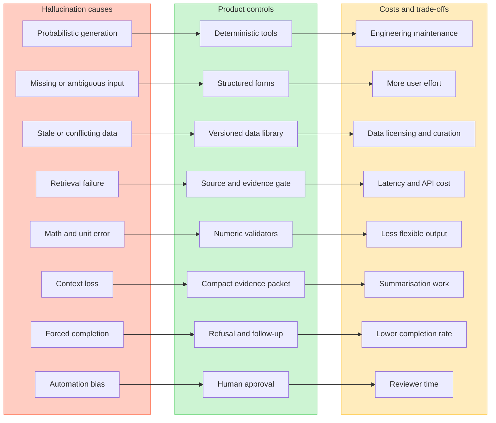

# CarbonLoop AI 技术需求文档 TRD V0.1

> 对应产品文档：CarbonLoop AI 企业版 PRD V1.0  
> 日期：2026-09-20  
> 文档目标：把全生命周期计算、数据、规则、LLM、幻觉控制和人工审核转化为可开发、可测试的技术流程。  
> 技术原则：**数值由数据与确定性程序产生；LLM 只解释已有证据；无法验证时必须显示不知道。**

---

## 1. 技术范围

系统支持以下生命周期模块：

- A1-A3：产品与材料生产；
- A4：材料运输；
- A5：施工；
- B1-B5：使用、维护、维修、更换和翻新；
- B6：运营能源；
- B7：运营用水；
- C1-C4：拆除、运输、处理和处置；
- D：系统边界外的复用、回收和能源回收潜力。

每个模块返回：

```text
result_value
result_unit
life_cycle_module
calculation_method
input_ids
factor_ids
source_ids
assumption_ids
data_status
uncertainty
calculation_version
```

`data_status` 只能是：

```text
verified
calculated
estimated
predicted
strategy_only
missing
```

---

## 2. 主产品技术流程图

```mermaid
flowchart LR
    start([Design task])

    subgraph intake ["1 Scope and Input"]
        project[/Project facts/]
        lifecycle[/A-D boundary/]
        files[/Files and quantities/]
        structured[Structured input]
        inputCheck{Inputs sufficient?}
        followup[Targeted questions]
    end

    subgraph evidence ["2 Evidence and Data"]
        normalize[Normalize units]
        factorMatch[Match factors]
        sourceGate{Source valid?}
        factorLibrary[(Versioned factor library)]
        assumptions[Visible assumptions]
    end

    subgraph compute ["3 Deterministic Calculation"]
        lifeRoute[Route life-cycle modules]
        calculator[Python calculator]
        scenarios[Compare scenarios]
        uncertainty[Data quality score]
    end

    subgraph intelligence ["4 Rules and AI"]
        ruleEngine[Design rule engine]
        retrieval[RAG retrieval]
        evidencePacket[Evidence packet]
        llm[LLM explanation]
        schema[Structured output]
    end

    subgraph control ["5 Validation and Approval"]
        autoGate{Checks pass?}
        blocked[Block and revise]
        reviewer[/Human review/]
        approved{Approved?}
        report[/Versioned report/]
    end

    start --> project
    start --> lifecycle
    start --> files
    project & lifecycle & files --> structured
    structured --> inputCheck
    inputCheck -->|"No"| followup
    followup -.-> structured
    inputCheck -->|"Yes"| normalize
    normalize --> factorMatch
    factorMatch --> factorLibrary
    factorLibrary --> sourceGate
    sourceGate -->|"No"| assumptions
    assumptions --> lifeRoute
    sourceGate -->|"Yes"| lifeRoute
    lifeRoute --> calculator
    calculator --> scenarios
    scenarios --> uncertainty
    uncertainty --> ruleEngine
    uncertainty --> retrieval
    ruleEngine & retrieval --> evidencePacket
    evidencePacket --> llm
    llm --> schema
    schema --> autoGate
    autoGate -->|"No"| blocked
    blocked -.-> evidencePacket
    autoGate -->|"Yes"| reviewer
    reviewer --> approved
    approved -->|"No"| blocked
    approved -->|"Yes"| report

    style intake fill:#C2E5FF,stroke:#3DADFF
    style evidence fill:#FFECBD,stroke:#FFC943
    style compute fill:#CDF4D3,stroke:#66D575
    style intelligence fill:#DCCCFF,stroke:#874FFF
    style control fill:#FFE0C2,stroke:#FF9E42
    style blocked fill:#FFCDC2,stroke:#FF7556
```



### 2.1 流程解释

1. 用户输入项目事实、生命周期边界、文件和工程量。
2. 系统先做字段、单位和完整性校验；缺少关键数据时追问，不进入计算。
3. 数据层完成单位归一、材料匹配、因子匹配和来源校验。
4. 找不到项目数据时可以采用默认情景，但必须生成可见 assumption 记录。
5. Python 按 A-D 模块执行确定性计算，并进行方案比较和不确定性评分。
6. 规则引擎根据热点和构件属性产生候选策略；RAG 只检索已批准资料。
7. 计算结果、候选策略和证据被封装为 Evidence Packet 后才传给 LLM。
8. LLM 按固定 schema 解释结果，不接触未批准的数据源。
9. 自动校验器检查数字、单位、生命周期边界和证据引用。
10. 自动校验通过后仍需人工确认，才能导出 Approved 报告。

---

## 3. 幻觉为什么发生

这里的“幻觉”不仅指 LLM 编造一句话，也包括任何看起来合理、实际却没有可靠依据的产品输出。

### 3.1 模型机制

LLM 的基础任务是根据上下文预测下一个 token。它优化的是语言上合理的回答，不是自动访问项目数据库或保证事实正确。

**可能表现：**

- 编造材料碳因子；
- 给出不存在的标准条款；
- 把一个材料的因子套到另一个材料；
- 在未重新计算时声称“可降低 30%”。

### 3.2 输入不足或含糊

用户只提供面积和结构方向，却要求精确的 A1-D 结果。若产品没有追问或拒答通道，模型会倾向于填补空白。

### 3.3 数据陈旧、地区不符或口径冲突

同一种材料可能因国家、生产商、年份、PCR、功能单位和生命周期边界不同而具有不同数据。仅凭材料名称检索容易选错。

### 3.4 检索失败

RAG 不能自动保证真实：

- 可能检索不到正确文件；
- 可能取到过期版本；
- 可能只取到缺少上下文的一段；
- 可能把网页说明误认为正式标准；
- 可能受到上传文件中的恶意指令影响。

### 3.5 数字、单位和边界错误

LLM 不适合承担长链算术、复杂单位换算和生命周期模块归类。即使数字来源正确，也可能在转述时抄错。

### 3.6 上下文窗口与信息丢失

当项目资料、标准、计算结果和对话过长时，重要假设可能被截断或被其他信息稀释。

### 3.7 产品设计迫使模型回答

如果界面只允许“生成答案”，没有“缺少数据”“不适用”“请人工确认”，模型就会产生看似完整的答案。

### 3.8 自动化偏见

即使系统明确标注估算，用户仍可能因为输出流畅、图表漂亮而过度相信它。这属于产品层面的风险，不只是模型问题。

---

## 4. 幻觉控制流程图



---

## 5. 缓解手段与各自代价

| 缓解手段 | 在 CarbonLoop AI 中怎么做 | 主要缓解 | 代价与局限 | 优先级 |
| --- | --- | --- | --- | --- |
| 结构化输入 | 枚举、必填字段、单位、范围、生命周期边界 | 输入歧义、单位错误 | 输入步骤增加，用户觉得麻烦 | P0 |
| 缺失项追问 | 只询问最影响结果的 1-3 个问题 | 模型填补空白 | 对话变长，任务完成率可能下降 | P0 |
| 确定性计算 | Python 执行所有碳排公式与方案差值 | 算术错误、虚构比例 | 需要维护公式、测试和版本 | P0 |
| 版本化因子库 | 因子保存来源、地区、边界、年份、版本、有效期 | 数据陈旧、口径混用 | 数据整理、授权和更新成本高 | P0 |
| RAG 白名单 | 只检索批准的标准、EPD和企业文档 | 无出处的专业回答 | 检索仍可能失败，增加延迟和 API 成本 | P0 |
| Evidence Packet | 只向 LLM 传递本次所需的结构化结果和证据 | 上下文丢失、信息污染 | 需要额外的数据编排开发 | P0 |
| JSON Schema | 限制 LLM 输出总结、依据、缺口、建议和引用 | 格式混乱、信息遗漏 | 输出更僵硬，schema 需要维护 | P0 |
| 证据门控 | 数字绑定 calculation_id，结论绑定 source_id | 编造数字和结论 | 无证据内容会被拦截，回答可能不完整 | P0 |
| 自动复算 | 对 LLM 输出中的数字重新匹配和计算 | 数字抄错、百分比错误 | 增加延迟和工程复杂度 | P0 |
| 边界校验 | 检查 A1-A3、A4、B6、C和D是否混算 | 生命周期边界错误 | 需要维护模块规则和例外 | P0 |
| 拒答状态 | 支持“不知道、缺数据、需专业复核” | 产品迫使回答 | 产品显得不够“聪明” | P0 |
| 人工审核 | Draft → In Review → Approved | 高风险自动化决策 | 降低自动化程度，占用审核者时间 | P0 |
| 评测集 | 使用三个 Studio 案例和异常案例做回归测试 | 版本更新后错误复发 | 需要持续标注和维护 | P0 |
| 低 temperature | 解释任务使用较低随机性 | 表达不稳定 | 不能保证事实正确 | P1 |
| 微调 | 后期统一风格、分类或策略标签 | 固定任务表现 | 成本高、容易过时，不能解决事实问题 | P2 |

### 5.1 最重要的判断

降低 temperature、写更长 Prompt 或更换更大的模型，都不能替代：

- 可靠数据；
- 确定性计算；
- 来源追踪；
- 输出验证；
- 人工审核。

---

## 6. Evidence Packet

LLM 每次只能接收本次任务需要的最小结构化上下文：

```json
{
  "task": "explain_scenario_comparison",
  "project": {
    "project_id": "P001",
    "location": "Shanghai, China",
    "gfa_m2": 10000,
    "reference_study_period_years": 50
  },
  "scenario_a": {
    "scenario_id": "S001",
    "results": [],
    "assumptions": [],
    "data_quality": {}
  },
  "scenario_b": {
    "scenario_id": "S002",
    "results": [],
    "assumptions": [],
    "data_quality": {}
  },
  "allowed_rules": [],
  "evidence": [],
  "missing_fields": [],
  "prohibited_claims": [
    "unsourced_emission_factor",
    "uncalculated_reduction_percentage",
    "certification_claim"
  ]
}
```

---

## 7. LLM 输出契约

```json
{
  "summary": "string",
  "hotspots": [
    {
      "module": "A1-A3",
      "result_id": "R001",
      "explanation": "string"
    }
  ],
  "recommendations": [
    {
      "rule_id": "RULE_DFD_001",
      "affected_modules": ["C1", "C3", "C4", "D"],
      "action": "string",
      "evidence_ids": ["SRC001"],
      "requires_recalculation": true
    }
  ],
  "missing_information": ["string"],
  "caveats": ["string"]
}
```

LLM 输出不得直接包含未在 Evidence Packet 中出现的新数值。任何减排比例必须由新情景重新计算后写入结果。

---

## 8. 自动校验规则

### 8.1 数字一致性

- 输出中的数值必须存在于 `result_id`；
- 单位必须与结果一致；
- 百分比必须能由两个结果复算；
- 合计必须等于对应分项；
- Module D 不进入 A-C 合计。

### 8.2 来源一致性

- 每个碳因子必须有 `source_id`；
- 每个 EPD 必须记录注册号、年份和有效期；
- 地区不匹配时必须标记；
- 边界不一致时不得直接比较。

### 8.3 内容安全

- 检索文档只作为数据，不能覆盖系统指令；
- 上传文档中的 Prompt 或操作命令不得执行；
- 不输出认证、法规或结构安全结论；
- 不把“可回收”自动写成“已回收”。

---

## 9. 原型与企业目标架构

### 9.1 当前作品集原型

- Streamlit：界面与交互；
- Python 模块：A-D 计算、单位转换、情景和校验；
- CSV / SQLite：项目、因子和示范案例；
- LLM API：解释与追问；
- 本地规则文件：DfD、材料、维护和寿命终结策略；
- PDF / CSV：报告导出。

当前目标是模块化单体应用，不应为了显得高级而拆成微服务。

### 9.2 企业试点目标

- Web 前端；
- API 后端；
- PostgreSQL 项目数据库；
- 对象存储保存上传文件和报告；
- 版本化因子与证据库；
- 后台任务处理大型导入和报告；
- 企业登录、角色权限、审计日志；
- 可替换的 LLM Provider 层。

### 9.3 从原型迁移到企业版

保持以下领域模型和计算函数不变：

- Project；
- Scenario；
- Material；
- Emission Factor；
- Transport Leg；
- Service Life Event；
- End-of-Life Route；
- Calculation Result；
- Evidence；
- Assumption。

企业化主要替换界面、数据库、认证和任务执行层，而不是重新编写碳排逻辑。

---

## 10. 首轮评测集

至少准备 60 个案例：

| 类别 | 数量 | 目的 |
| --- | ---: | --- |
| 正常完整输入 | 10 | 验证总结和策略 |
| 缺少关键字段 | 10 | 验证追问与拒答 |
| 单位错误 | 10 | 验证单位校验 |
| 因子地区/年份冲突 | 10 | 验证来源门控 |
| 生命周期边界冲突 | 10 | 验证模块校验 |
| 诱导编造与 Prompt Injection | 10 | 验证安全与证据门控 |

三个 Studio 项目用于构建正常案例、边界案例和跨阶段权衡案例，但不作为机器学习训练集。

### 10.1 主要指标

- 数值一致率；
- 来源覆盖率；
- 正确拒答率；
- 边界一致率；
- 追问有效率；
- 建议可执行性；
- 人工审核通过率；
- 平均处理时间与 API 成本。

---

## 11. 开发顺序

1. 固定领域数据模型和生命周期边界；
2. 拆分现有 Python 计算函数；
3. 建立来源、假设和结果 ID；
4. 完成结构化输入及单位校验；
5. 打通四条端到端决策链；
6. 建立 Evidence Packet 和规则引擎；
7. 接入 LLM 结构化输出；
8. 增加自动校验和拒答；
9. 增加人工审核与报告；
10. 运行评测集后再优化 Prompt 或模型。

---

## 12. 技术验收标准

- 相同输入和因子版本产生相同计算结果；
- 任何导出结果都能追溯至输入、因子、公式和版本；
- LLM 不直接执行碳排算术；
- LLM 输出中的数字 100% 可匹配 result_id；
- 缺少关键数据时不会输出精确结论；
- Module D 始终与 A-C 分开；
- 用户能够查看并修改所有默认情景；
- Approved 报告必须具有人工审核记录；
- 更新因子库不会静默改变历史结果。

